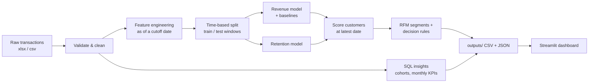

# RetainIQ: Customer Revenue Forecasting & Retention Analytics

Predict how much each customer will spend in the next 90 days, estimate who is likely to stop buying, and turn both into a prioritised retention action list, with an interactive Streamlit dashboard on top.

Built on the public **UCI Online Retail** dataset (UK-based online gift retailer, Dec 2010 – Dec 2011).

> **Status note.** The code was developed and tested with the *synthetic* data generator in `src/retainiq/synthetic.py` because the real dataset could not be downloaded in the build environment. Run the pipeline on the real dataset (instructions below) and paste your own numbers into the [Results](#results) section. No real-data metrics are claimed in this repo until you do.

---

## Business problem

Retailers spend heavily to acquire customers but rarely know **who will generate revenue next quarter**, **who is about to lapse**, and **where retention budget should go**. RetainIQ answers those three questions per customer and maps each answer to a recommended action.

## Features

| Area | What it does |
|---|---|
| Data validation & cleaning | Schema checks, type coercion, removes missing customer IDs, cancellations, non-positive quantity/price, fee codes (POST, BANK CHARGES…), exact duplicates. Writes an auditable per-step cleaning report. |
| Feature engineering | 13 customer-level features (recency, frequency, monetary, tenure, purchase velocity, gap between orders, product breadth, rolling 30/90/180-day revenue…) built with **strict time-based leakage control**. |
| Revenue model | Gradient boosting tuned with `RandomizedSearchCV` (5-fold CV) vs. three baselines (mean, "same as last 90 days", Ridge). |
| Retention model | Classifier for "will the customer purchase again in the horizon?" → churn probability. |
| Segmentation & decisions | RFM quintile scores → named segments; value tier (top 20% / next 30% / rest) × churn-risk bucket → recommended action. |
| Cohort analysis | Monthly acquisition-cohort retention heatmap. |
| SQL analysis | Five documented SQLite queries (monthly revenue, top countries/products, repeat-purchase rate, revenue concentration with window functions). |
| Dashboard | Filters (segment, tier, risk, country, churn threshold), KPIs, charts, model-performance tab, CSV export. |
| Tests | 29 automated tests incl. feature-leakage, hand-computed values, SQL-vs-pandas cross-checks, and dashboard smoke tests. |

## Architecture



### Time-based validation (why the numbers are trustworthy)

With snapshot date `T` (last transaction) and horizon `H` (default 90 days):

| Table | Features use data up to | Target = activity during |
|---|---|---|
| Train | `T − 2H` | `(T − 2H, T − H]` |
| Test | `T − H` | `(T − H, T]` |
| Scoring | `T` | the *next* `H` days (unknown, this is the forecast) |

The test window is strictly later than the training window, and a unit test verifies features never see data after their cutoff. Final models are refit on train+test before scoring.

The horizon defaults to 90 days (not 180) because the dataset spans only ~13 months and two full horizons plus history are needed.

## Project structure

```
retainiq/
├── app/dashboard.py            # Streamlit dashboard
├── scripts/run_pipeline.py     # CLI entry point
├── src/retainiq/
│   ├── config.py               # paths, thresholds, constants
│   ├── data_loader.py          # load + validate csv/xlsx
│   ├── cleaning.py             # cleaning with audit report
│   ├── features.py             # leakage-safe feature engineering
│   ├── modeling.py             # tuned models, baselines, metrics
│   ├── segmentation.py         # RFM, value tiers, actions
│   ├── cohort.py               # cohort retention, monthly KPIs
│   ├── sql_analysis.py         # runs sql/queries.sql on SQLite
│   ├── pipeline.py             # orchestration + exports
│   └── synthetic.py            # SYNTHETIC demo data (testing only)
├── sql/queries.sql
├── tests/                      # pytest suite
├── data/raw/                   # put the dataset here (gitignored)
├── outputs/                    # generated (gitignored)
├── requirements.txt
└── .gitignore
```

## Setup

Requires Python 3.10+ (3.11+ recommended).

```bash
# 1. create and activate a virtual environment
python -m venv venv
venv\Scripts\activate          # Windows (VS Code terminal / PowerShell)
# source venv/bin/activate     # macOS / Linux

# 2. install dependencies
pip install -r requirements.txt
```

### Get the dataset

1. Download **Online Retail** from https://archive.ics.uci.edu/dataset/352/online+retail
2. Unzip it and put `Online Retail.xlsx` in `data/raw/`.

(Reading the ~540k-row Excel file takes about a minute. Saving it as `Online Retail.csv` in the same folder makes later runs faster.)

## Run

```bash
python scripts/run_pipeline.py            # real data from data/raw/
streamlit run app/dashboard.py            # open http://localhost:8501
```

Useful options: `--input <path>`, `--horizon-days 90`, `--n-iter 30`, `--cv 5`.
No dataset yet? `python scripts/run_pipeline.py --sample` runs on **synthetic** demo data (the dashboard shows a warning banner so it can't be mistaken for real findings).

## Test

```bash
python -m pytest -q
```

Verified on: Python 3.13 with pandas 3.0.5 / scikit-learn 1.9.1 / streamlit 1.65.0, and with pandas 2.3.3 / scikit-learn 1.6.1: 29 passed in both.

## Results

> Fill this in from **your** run on the real dataset (`outputs/real/metrics.json`, dashboard → *Model performance*). Do not copy numbers from another project.

| Model | MAE | RMSE | R² (raw) | R² (log) | Top-20% revenue capture |
|---|---|---|---|---|---|
| Baseline: mean | | | | | |
| Baseline: last-90-days persistence | | | | | |
| Ridge | | | | | |
| Gradient boosting (tuned) | | | | | |

Retention model (held-out window): ROC-AUC = ____ , PR-AUC = ____ , base rate = ____

Sample insights to write up from the SQL tab: revenue share of the top customer quintile, repeat-purchase rate, top countries/products, strongest features.

### Screenshots

After running the dashboard, capture the *Overview*, *Segments & actions* and *Cohorts* tabs and save them in `docs/screenshots/`, then reference them here, e.g. ``.

## Limitations & future work

- Dataset covers a single UK retailer for about 13 months, so seasonality (e.g. Christmas peak) cannot be learned across years.
- Revenue is heavy-tailed; raw-scale R² is dominated by a few large wholesale customers, so log-scale R² and revenue-capture are reported too.
- "Churn" = no purchase within the horizon; it is a proxy for non-contractual retail, not a cancelled subscription.
- Recommended actions are rule-based starting points, not causal estimates of campaign uplift (would need A/B tests).
- Future work: SHAP explanations, rolling multi-cutoff training, probability calibration, Docker/CI.

## Credits

- Dataset: Chen, D. (2015). *Online Retail* [Dataset]. UCI Machine Learning Repository. https://doi.org/10.24432/C5BW33 (CC BY 4.0).
- Problem framing inspired by the public repository *Revenue-prediction-retention-decision-system* by Bhavesh2123. This project is an independent implementation (different features, validation protocol, models, SQL layer, dashboard and tests).
